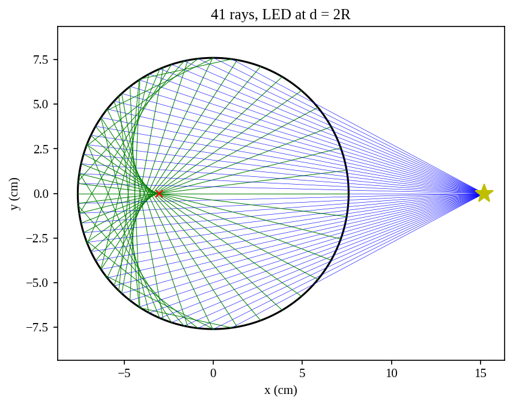
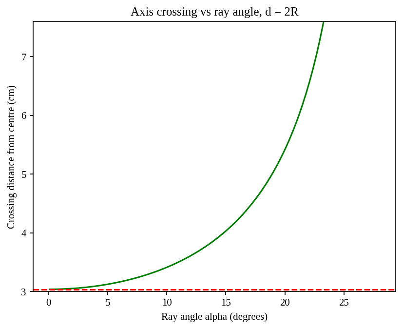
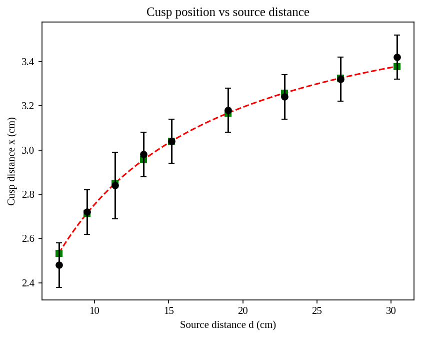
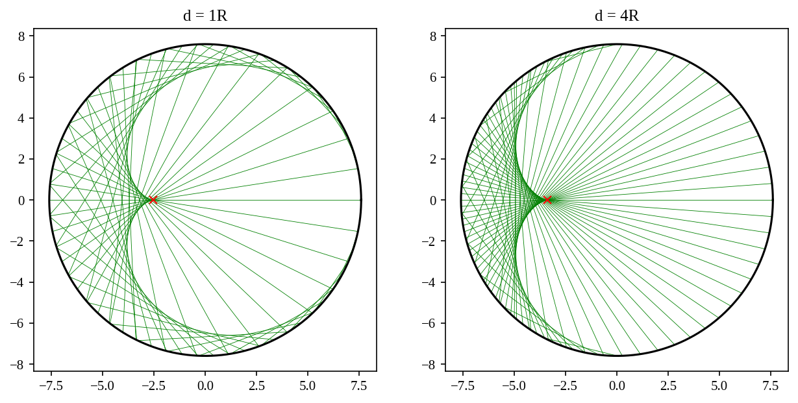

# Caustic Ray-Tracing Simulation

A 2D ray-tracing simulation of the caustic formed inside a concave
cylindrical mirror, compared with measurements from my IB Physics
Extended Essay.

## Background

In my Extended Essay I placed a phone LED at different distances d from the
centre of a steel cake ring (radius R = 7.60 cm) and measured the distance x
from the centre to the cusp of the caustic. The paraxial mirror equation
predicts

    x = Rd / (2d + R)

This project simulates the same setup by tracing individual rays, to see
where the caustic comes from and why the mirror equation predicts the cusp
so well.

## Method

- The ring is a circle of radius R centred at the origin; the LED is a point
  source on the x-axis at distance d.
- Each ray is a start point plus a direction vector. Its hit point on the far
  wall is found by solving a quadratic.
- The ray is reflected using r = v − 2(v·n)n, where n is the unit normal.
- The caustic appears as the envelope of the reflected rays.

## Results

### The caustic

### Spherical aberration

At d = 2R, a ray at 0.01° crosses the axis 3.0400 cm from the centre, which
matches the mirror equation (3.04 cm). A ray at 5° crosses at 3.126 cm, and
the error grows quickly for steeper rays. The cusp is formed by the
near-axis rays, so the mirror equation gives its position exactly, while
the steeper rays form the arms of the caustic.

### Comparison with experiment

Across nine source distances from 1R to 4R, the measured cusp positions
agree with the simulation with an RMSE of 0.026 cm. The largest differences
are at 1R (−0.053 cm) and 4R (+0.042 cm).

### Shape of the caustic

At d = 1R the caustic is cardioid-like, with its cusp at R/3. By d = 4R it
approaches the nephroid of parallel light, with its cusp near R/2.

## Limitations

- The simulated cusp is the paraxial limit of the ray tracer, so it equals
  the mirror-equation value by construction. The comparison with experiment
  therefore tests the mirror equation; it is not an independent prediction.
- The LED is modelled as a point source. The real LED was 3 mm wide, which
  blurs the cusp.
- The model is 2D and uses geometric optics only: a perfectly circular,
  perfectly reflecting ring, with no diffraction.
- The LED's height and the blocking of light by the near rim are not modelled.
- The experimental values are means of 5 ruler readings (±0.1 cm) at each
  of 9 positions.

## Files

- The `.ipynb` notebook: the full simulation (opens in Google Colab)
- `*.png`: figures

## Tools

Python, NumPy, matplotlib.
